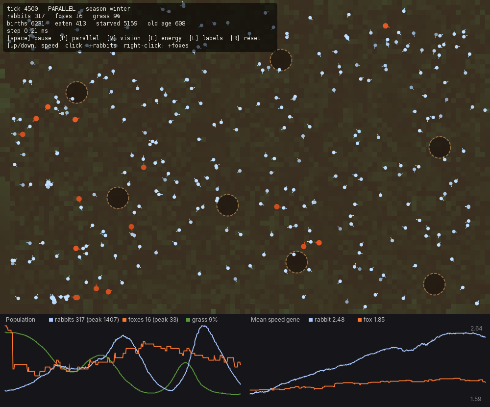
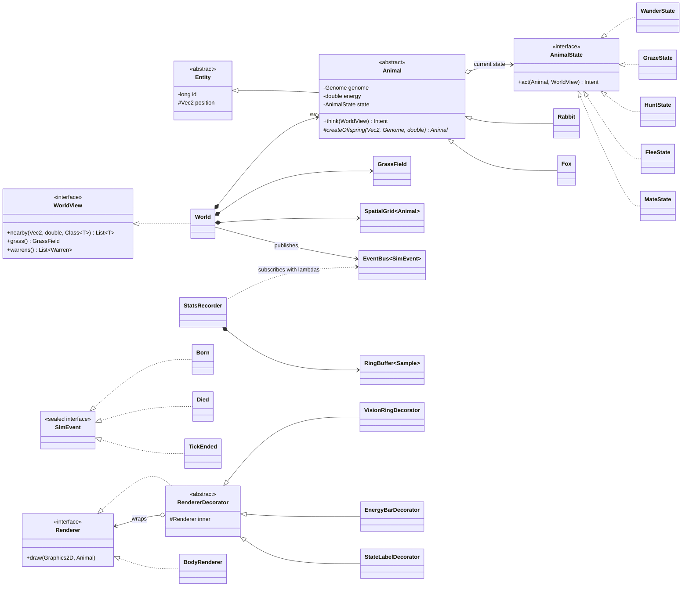

# Predator–Prey Ecosystem

A COMP2000 simulation of rabbits, foxes and grass in which **population cycles, refuge-seeking and an evolutionary arms race emerge** from simple per-animal rules. Pure Java (standard JRE only, Java 17+), drawn on a `JPanel` in a `JFrame`.



## Run it

```bash
javac -d out $(find src -name "*.java")      # Windows PowerShell: javac -d out (Get-ChildItem -Recurse src -Filter *.java).FullName
java -cp out ecosim.Main                     # open the window
java -cp out ecosim.Main --headless 5000     # run 5000 ticks, print a census every 200
java -cp out ecosim.Main --benchmark         # time sequential vs parallel ticks
```

Settings are read from `ecosim.properties` if it exists. A bad value is reported and the defaults are used.

| Key | Action |
|---|---|
| `Space` | pause / resume |
| `P` | toggle parallel / sequential update |
| `V` / `E` / `L` | toggle vision rings / energy bars / state labels |
| `↑` / `↓` | simulation speed (1–20 ticks per frame) |
| `R` | reset |
| left click / right click | drop 15 rabbits / 3 foxes at the cursor |

## What emerges (nothing below is scripted)

- **Boom–bust cycles.** Grass → rabbits → foxes oscillate, driven by seasons and predation.
- **Arms race.** Speed is heritable and costs energy every tick. Rabbit speed evolves up under predation, and fox speed follows a few generations behind.
- **Rabbits trade eyesight for speed.** Vision also costs energy, and the population reliably evolves *shorter* vision while getting faster.
- **Refuge behaviour.** Fleeing rabbits curve towards burrows, and the burrows end up ringed by over-grazed ground.

## Architecture



| Package | Responsibility |
|---|---|
| `ecosim.model` | the world, animals, genome, grass, spatial index |
| `ecosim.behaviour` | one class per behaviour state |
| `ecosim.events` | sealed event types and the generic `EventBus` |
| `ecosim.stats` | custom collector, ring-buffer history, recorder |
| `ecosim.view` | Swing window, world/graph panels, decorator renderers |
| `ecosim.config` | `SimConfig` record and checked `ConfigException` |

## One tick

1. Rebuild the spatial index (sequential).
2. **Think**: every animal returns an `Intent` (a **parallel stream**; the world is read-only here).
3. **Apply**: intents are applied one at a time in random order, which resolves conflicts such as two foxes chasing the same rabbit.
4. Remove the dead, add newborns, regrow grass (a parallel `IntStream` over rows).
5. Census with a custom `Collector` in a parallel `groupingBy`.
6. Publish `TickEnded` to observers.
